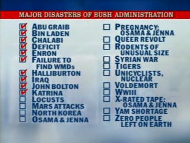

I always love to watch Comedy Central's "[The Daily Show with Jon Stewart](http://www.comedycentral.com/shows/the_daily_show/index.jhtml)".  
They recently had a one week break and were back on the air last night.

The show was funny and sharp as hell, I especially liked the recap of George Bush's total lack of leadership and denial of responsability.

And then correspondent [Ed Helms layed it on](//a386.v99506.c9950.g.vm.akamaistream.net/7/386/9950/v001/comedystor.download.akamai.com/9951/com/dailyshow/helms/helms_10111.wmv)... (wmv)

He discussed Bush's list of failures so far. "As you know, administration fiascos are named alphabetically..."  
 
By way of the list he hasn't made thà t many faults, now has he? ;)

Another great snippet of Ed Helms' piece:  
**Ed Helms:** *"And here's the thing Jon, while everybody else is busy setting up commissions and finding fault through the President's leadership, he'll end up building a billion dollar dam in Arkansas."*  
**Jon Stewart:** *"Why would he build a dam in Arkansas?"*  
**Ed Helms:** *"His plan will be to fight the water there so we don't have to fight it here in New Orleans."*

The Daily Show is one of my favourite shows of all time.  
Stay tuned for more reviews of this fantastic programme.